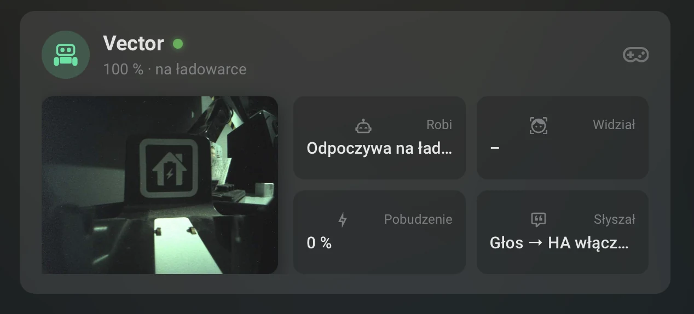
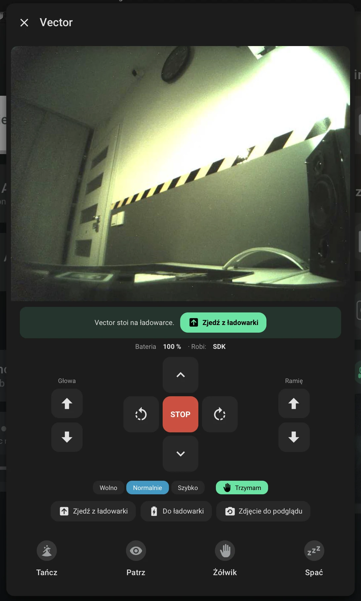
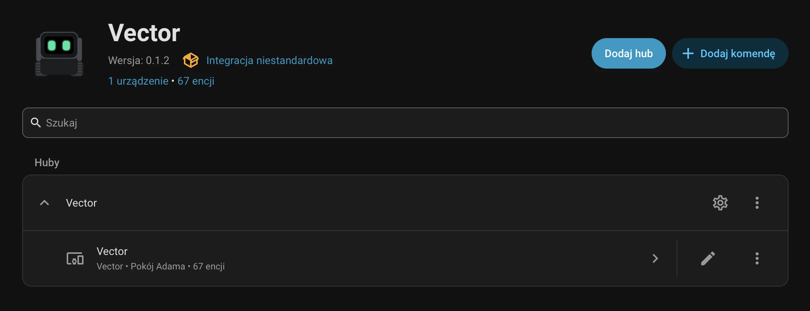
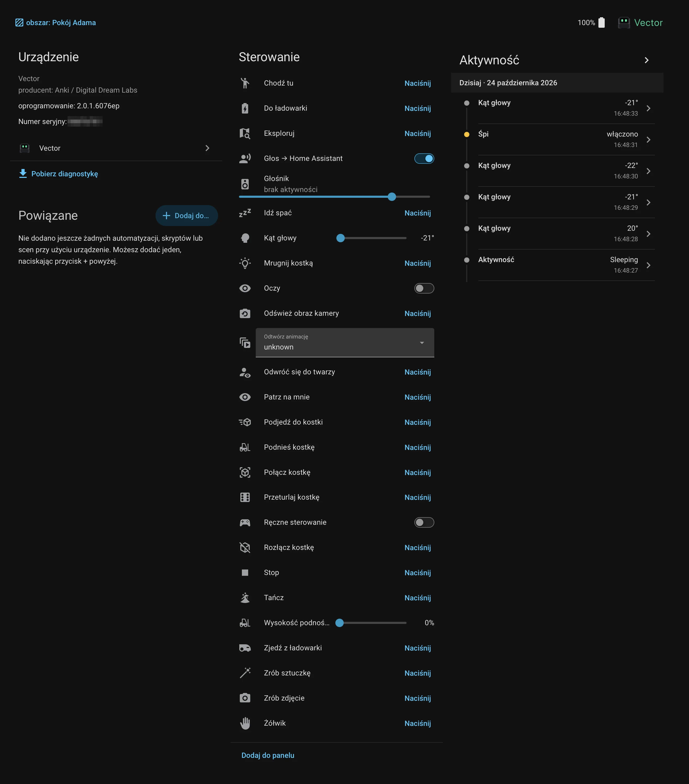
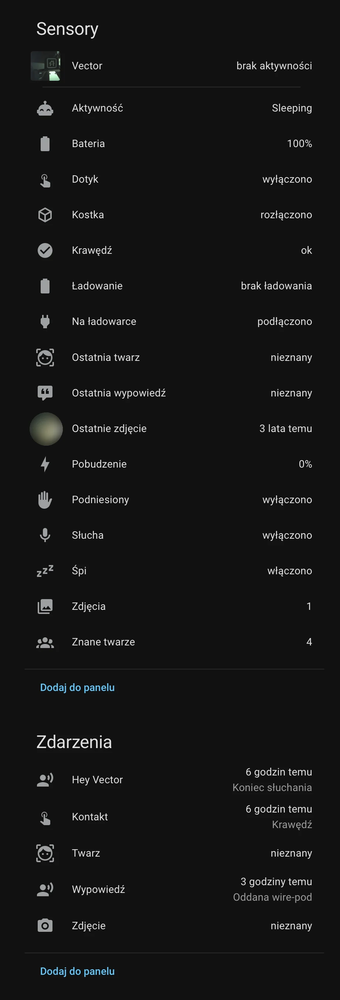
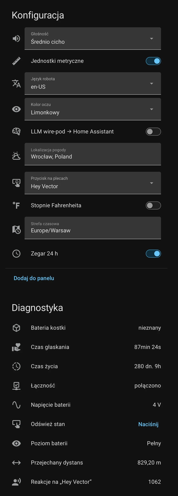

# Vector for Home Assistant

🇵🇱 [Polska wersja](README.pl.md)

A Home Assistant custom integration for the **Anki / Digital Dream Labs Vector** robot. It talks to
the robot through the [Vector add-on](https://github.com/witold-gren/home-assistant-vector-addon)
(the `vector-bridge`), which runs next to [wire-pod](https://github.com/kercre123/wire-pod) and
exposes a local WebSocket API. Everything stays on your network — no cloud.

With it you can watch Vector's sensors, drive him from a dashboard, use his camera and speaker, and
let him control your home: "Hey Vector, turn on the living room light" goes to Assist.

## Screenshots

**Dashboard**: a tile with the camera, battery and what Vector is doing, and a popup with the
[control card](#control-card) (drive, head, lift, hold, charger).

<table>
  <tr>
    <td width="54%"></td>
    <td width="46%"></td>
  </tr>
</table>

**Integration**: one hub per bridge, one device per robot, and custom voice commands
(**Add command**).



**Device page**: controls and activity; sensors and events; configuration and diagnostics.



<table>
  <tr>
    <td width="50%"></td>
    <td width="50%"></td>
  </tr>
</table>

## Contents

- [Screenshots](#screenshots)
- [Requirements](#requirements)
- [Installation](#installation)
- [Configuration](#configuration)
- [Entities](#entities)
- [Services](#services)
- [Voice → Assist](#voice--assist)
- [Custom voice commands](#custom-voice-commands)
- [Events](#events)
- [Dashboard examples](#dashboard-examples)
- [Child's program (Robots Code Studio)](#childs-program-robots-code-studio)
- [Limitations](#limitations)

## Requirements

- Home Assistant 2026.2 or newer.
- A Vector robot (Vector 1.0 or 2.0) set up with **wire-pod**.
- The **Vector add-on** from
  [home-assistant-vector-addon](https://github.com/witold-gren/home-assistant-vector-addon)
  (Home Assistant OS / Supervised), or another reachable `vector-bridge` instance.

## Installation

### HACS (recommended)

1. In HACS open the menu → **Custom repositories**.
2. Add `https://github.com/witold-gren/home-assistant-vector-integration` with category
   **Integration**.
3. Install **Vector** and restart Home Assistant.

### Manual

Copy `custom_components/vector` into `<config>/custom_components/vector` and restart Home Assistant.

## Configuration

When the Vector add-on is running, Home Assistant discovers it through the Supervisor and offers to
set it up under **Settings → Devices & services**. Without the Supervisor, add the **Vector**
integration manually and enter the bridge host, port (default `3012`) and token.

Every robot known to wire-pod becomes a device. When a new robot is added in wire-pod, the
integration reloads and creates its entities.

Integration options (**Configure**):

| Option | Meaning |
| --- | --- |
| Assist agent | Conversation agent that receives what Vector heard. |
| Vector says the answer | Whether Vector says the Assist response. |
| Keep on Vector | Phrases that always stay with wire-pod (one per line). |
| Answer voice | wire-pod (its own TTS, e.g. Piper) or a Home Assistant TTS engine. |
| TTS engine / language / voice | Used when the answer voice is a Home Assistant TTS engine. |
| Agent for wire-pod LLM questions | Answers wire-pod's LLM questions when that switch is on. |

## Entities

Entity IDs are English in every Home Assistant language (e.g. `sensor.vector_battery` also in a
Polish installation, not `sensor.vector_bateria`); the displayed names are translated. The
examples assume a robot named "Vector".

| Platform | Entities |
| --- | --- |
| Binary sensor | Connection, charging, on charger, picked up, touched, cliff, sleeping, listening, cube, program (a child's program runs; add-on 0.3.0+) |
| Sensor | Battery, battery voltage, battery level, activity, stimulation, last face, known faces, photos, last speech, time alive, petting time, distance driven, wake word reactions, cube battery |
| Button | Go to charger, drive off charger, stop, dance, explore, go to sleep, come here, look at me, fist bump, do a trick, take a photo, turn to last face, refresh state, refresh camera image, cube actions |
| Number | Head angle, lift height |
| Select | Volume, eye color, robot language, back button, play animation |
| Light | Eyes (any custom color) |
| Switch | Manual control, Voice → Home Assistant, wire-pod LLM → Home Assistant, 24-hour clock, metric units, Fahrenheit |
| Text | Time zone, weather location |
| Camera | Live stream on demand (WebRTC with sound, add-on 0.2.0+; MJPEG with older add-ons), cached snapshot |
| Image | Last photo, last frame of the live view (kept in Home Assistant, always available — the card's full-screen background) |
| Media player | Vector's speaker (`tts.speak`, media files, audio URLs) |
| Event | Wake word, interaction, face, photo, speech, program (started / ended, with the reason) |

Cube entities are disabled by default until the robot knows a cube. Vector's photos are also
available in the media browser under **Media → Vector**.

## Services

All services accept an optional `device_id` (required only with more than one robot).

| Service | Description |
| --- | --- |
| `vector.say_text` | Vector says the text (`engine`: default, wirepod, tts, vector). |
| `vector.play_animation` | Play an animation by name. |
| `vector.play_animation_trigger` | Play a random animation of a trigger group. |
| `vector.list_animations` | Return the animation (or trigger) names the robot knows. |
| `vector.run_intent` | Run a voice-command behavior, e.g. `intent_imperative_dance`. |
| `vector.drive_straight` | Drive forward or back. |
| `vector.turn` | Turn in place. |
| `vector.drive_wheels` | Run both wheels for a while, then stop. |
| `vector.move` | Wheels, head and lift at given speeds; stops 0.7 s after the last call. |
| `vector.go_to` | Drive to a point, avoiding obstacles. |
| `vector.turn_towards_face` | Turn to a known face (default: the last one seen). |
| `vector.go_to_cube` | Drive to the connected cube. |
| `vector.set_eye_color` | Custom eye color until the next settings change or reboot. |
| `vector.stop` | Stop the current action and give control back to Vector. |
| `vector.list_photos` | Photos stored on the robot, newest first. |
| `vector.delete_photo` | Delete a photo stored on the robot. |
| `vector.list_faces` | Faces Vector knows by name. |
| `vector.rename_face` | Rename a known face. |
| `vector.delete_face` | Vector forgets a face. |
| `vector.enroll_face` | Vector learns the face in front of him under a name. |

## Voice → Assist

With the **Voice → Home Assistant** switch on, every sentence Vector hears (transcribed by wire-pod)
is checked in this order:

1. **Custom voice commands** (see below) — matched locally, handled by Home Assistant.
2. **Keep on Vector** — if the sentence contains one of these phrases, it goes straight back to
   wire-pod. The defaults depend on the Home Assistant language (English: "what time is it",
   "weather", "timer", "take a photo", "dance", "go to sleep", "good night", …) and can be edited in
   the options.
3. **Assist** — the configured agent gets the sentence. If it understands it, Home Assistant acts
   and Vector speaks the answer (via wire-pod's TTS or a Home Assistant TTS engine, see *Answer
   voice*). If it does not understand or does not answer in time (~7 s), wire-pod handles the
   sentence as usual (time, weather, its own LLM…).

The **wire-pod LLM → Home Assistant** switch goes one step further: questions wire-pod would send to
its own LLM are answered by a Home Assistant conversation agent instead.

The `Last speech` sensor, the `Speech` event entity and the `vector_speech` event show what was
heard and what happened to it.

## Custom voice commands

Add commands under **Settings → Devices & services → Vector → Add command**. Each command has:

- **Sentences**, one per line, in Assist syntax:
  - `good night [vector]` — `[...]` is optional,
  - `(turn off|switch off) everything` — `(a|b)` are alternatives,
  - `play {song}` — `{slot}` matches any text.
- An optional **response** Vector says; `{song}` in the response is replaced with the matched value.
- An optional **script**, started with the variables `text`, `slots`, `esn` and `device_id`.
- An optional **robot reaction** (dance, sleep, fist bump, …) or an **animation** group.

Every match also fires the `vector_command` event. Commands are checked before *Keep on Vector*
and before Assist.

## Events

| Event | Fired when |
| --- | --- |
| `vector_wake_word` | Vector hears the wake word. |
| `vector_touched` | Vector's back is touched. |
| `vector_picked_up` | Vector is picked up. |
| `vector_cliff` | Vector detects a cliff. |
| `vector_button_pressed` | The back button is pressed. |
| `vector_face_seen` | Vector sees a face. |
| `vector_intent` | Vector recognizes a voice intent. |
| `vector_cube_tapped` | The cube is tapped. |
| `vector_control_lost` | Behavior control is taken back by the robot. |
| `vector_photo_taken` | Vector takes a photo. |
| `vector_audio_started` | Audio starts playing on the speaker. |
| `vector_audio_finished` | Audio finishes playing. |
| `vector_speech` | A sentence went through the voice router (text, decision, answer). |
| `vector_command` | A custom voice command matched (command, slots, text). |
| `vector_program_started` | A child's program started (`owner`, `since`, `limit`, `heartbeat`). |
| `vector_program_ended` | A child's program ended (`owner`, `reason`, `cause`, `duration`). |

## Dashboard examples

### Control card

The integration serves the `custom:vector-control-card` automatically — no Lovelace resource is
needed. Its UI is English, or Polish when Home Assistant is set to Polish.

```yaml
type: custom:vector-control-card
camera: camera.vector
# speed: 120      # mm/s forward (optional)
# hold: true      # take control while the card is open (default)
```

- **Hold to drive**: the arrows, head and lift buttons move Vector only while pressed. The card
  repeats `vector.move` every 300 ms and Vector stops 0.7 s after the last call, so he also stops
  when the network drops or the window closes. **STOP** stops everything.
- **Control while you steer**: the full-screen view turns on the *Manual control* switch while it
  is open (Vector stands still and waits for commands), and so does the first drive in the tile;
  control is given back when the view closes, a minute after the last drive in the tile, or when
  the page goes to the background. The **Hold** toggle keeps it on until pressed again; `hold: false`
  disables the automatic part.
- **Loader**: a spinner shows until the first frame arrives (Vector may need a few seconds, longer
  on the charger). The tile has its own 🔊 button while the live view runs.
- **On the charger** a bar with **Drive off charger** appears, and the forward arrow drives Vector
  off the charger.
- **Live camera**: tap ▶ to watch. With the Vector add-on 0.2.0 or newer this is real video
  (WebRTC through Home Assistant's go2rtc) with Vector's microphone; older add-ons fall back to
  MJPEG. Before that the card shows the last cached frame (or a "preview is off" screen) and never
  wakes the camera by itself. The live view stops when you tap ✕, after 5 minutes without a touch,
  and when the page goes to the background.
- **Full-screen control** (⛶): landscape, the camera fills the screen. Driving pad (forward, back,
  turn, STOP) on the left; listen to Vector (🔊), head and lift on the right; speed and charger
  buttons at the bottom. On an iPhone the view keeps clear of the Dynamic Island. Sound starts
  muted (browsers only allow sound after a tap) — tap 🔊 to hear Vector.
- **Unavailable robot**: the card says so and disables the controls instead of showing a broken
  image and "unavailable %".

### Popup with browser_mod

With [browser_mod](https://github.com/thomasloven/hass-browser_mod), a tile can open the card plus
a few behavior buttons in a popup:

```yaml
type: tile
entity: sensor.vector_battery
name: Vector
icon: mdi:robot-happy
tap_action:
  action: fire-dom-event
  browser_mod:
    service: browser_mod.popup
    data:
      title: Vector
      content:
        type: vertical-stack
        cards:
          - type: custom:vector-control-card
            camera: camera.vector
          - type: grid
            columns: 4
            square: false
            cards:
              - type: tile
                entity: button.vector_dance
                vertical: true
                hide_state: true
                tap_action:
                  action: perform-action
                  perform_action: button.press
                  target:
                    entity_id: button.vector_dance
              # … same for button.vector_look_at_me, button.vector_fist_bump, button.vector_go_to_sleep
```

Entity IDs depend on the Home Assistant language at the time the integration was set up (for
example, a Polish install gets Polish entity IDs). Check yours under **Settings → Entities**.

## Child's program (Robots Code Studio)

With add-on 0.3.0+, Robots Code Studio (a block / Python editor for children) can run a child's
program on Vector step by step. While it runs, **Program** (`binary_sensor.vector_program`) is on
(attributes: who started it, since when, its time limit), the control card greys its controls out
and says "Child's program running", and the add-on refuses motion, animation and speech from Home
Assistant. **STOP** on the card (or `vector.stop`) always works and ends the program. The add-on
also stops the robot when the studio stops answering, at the time limit and when Vector takes
control back (a table edge, being picked up). Setting it up (studio token, port 3012): see the
add-on's documentation, section *Robots Code Studio*.

During a program the robot reports the activity `SDK`; the **Activity** sensor
(`sensor.vector_activity`) shows **`ChildProgram`** instead (attribute `robot_activity`: the raw
value from the robot). In Home Dashboard give it a label in the tile's status, e.g.
`labels: {ChildProgram: "Program dziecka"}`, and a STOP button that shows only during a program:
`quick: {name: STOP, icon: mdi:stop-circle-outline, service: vector.stop, data: {device_id: <id>},
active: binary_sensor.vector_program}` (`device_id` may be left out when there is only one
robot; `vector.stop` takes no entity target).

`event.vector_program` and the bus events `vector_program_started` / `vector_program_ended` are for
automations, e.g. a notification when a program ends with `reason: control_lost`:

```yaml
triggers:
  - trigger: event
    event_type: vector_program_ended
    event_data:
      reason: control_lost
actions:
  - action: notify.notify
    data:
      message: "Vector stopped the program ({{ trigger.event.data.cause }})"
```

End reasons: `end`, `stop`, `error` (from the program), `watchdog` (the studio stopped answering),
`limit`, `ha_stop` (STOP in Home Assistant), `control_lost` with `cause` `cliff`, `picked_up`,
`falling`, `wake_word`, `robot`, `connection`, and `disconnected` with `cause` `client` or `robot`.

### FAQ

**The card does nothing and says "Child's program running".** A child's program drives Vector; only
the program may move him now. Tap **STOP** to end it — the card works again at once.

**The program stopped by itself ("Vector saw an edge").** Vector's own safety reflexes took control
back (`reason: control_lost`, `cause: cliff` or `picked_up`). Move him away from the edge or put him
down, then start the program again.

**Announcements through Vector are silent during a program.** The add-on lets only the program use
the speaker while it runs; they work again after the program ends.

## Limitations

- **Half-grey full-screen background (last frame)** before 0.2.6: Home Assistant saved only the part
  of the card's upload that had arrived so far (a phone uploading slowly left a cut JPEG; intercom
  messages could be cut too). Update to 0.2.6 and restart Home Assistant; the next live view stores
  a whole frame.
- **Face screen images** are not supported: on Vector 2.0 writing images to the face screen crashes
  the robot.
- **Camera** gives about 2 new pictures per second (a limit of Vector's SDK camera feed). The live
  stream repeats the last picture at 10 fps, so it plays smoothly, but motion still updates about
  twice a second.
- **Microphone**: Vector's SDK audio feed is not documented in detail; if the sound plays too fast or
  too slow, set the add-on option *Microphone sample rate* to the value its log shows.
- **Camera on the charger**: while Vector sits on the charger the camera needs behavior control, so
  Vector holds still while someone watches the stream.
- Long or endless audio streams are not supported on the speaker; the bridge plays whole files
  (up to 50 MB).

## License

[MIT](LICENSE)
