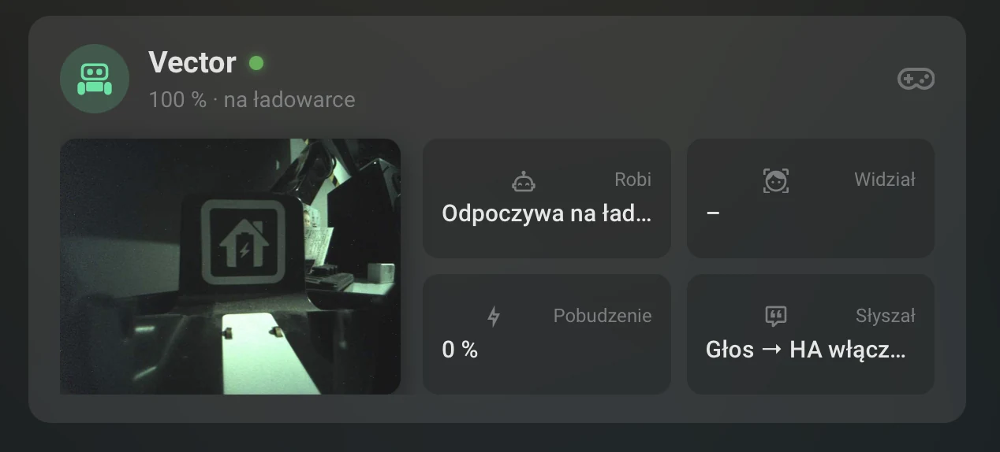
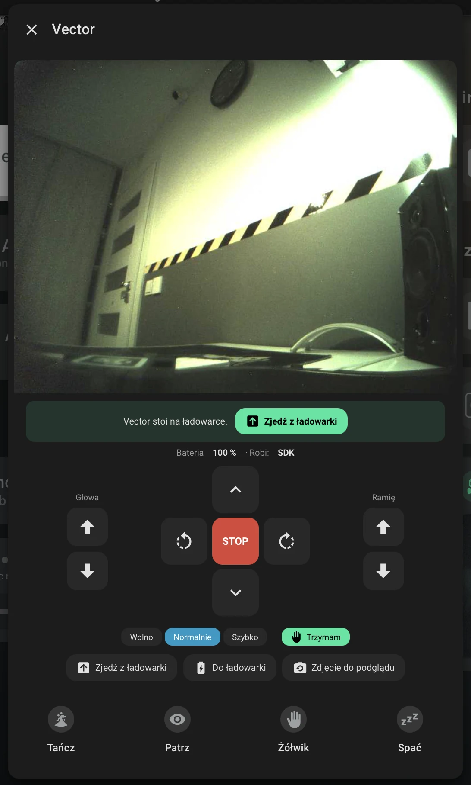
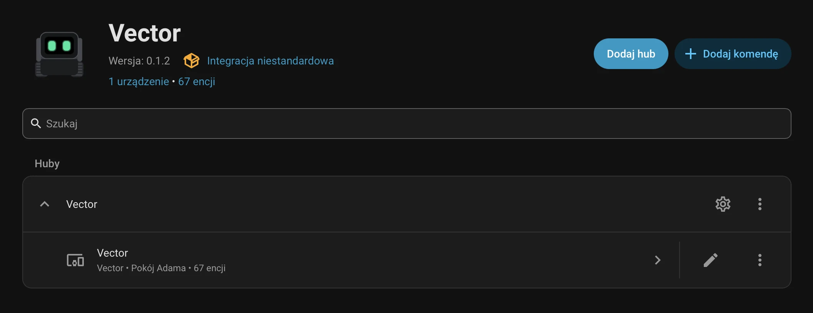
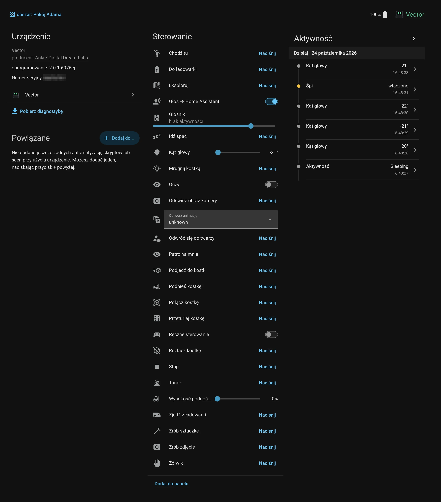
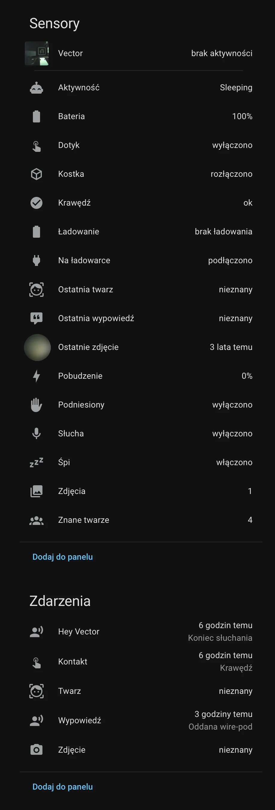
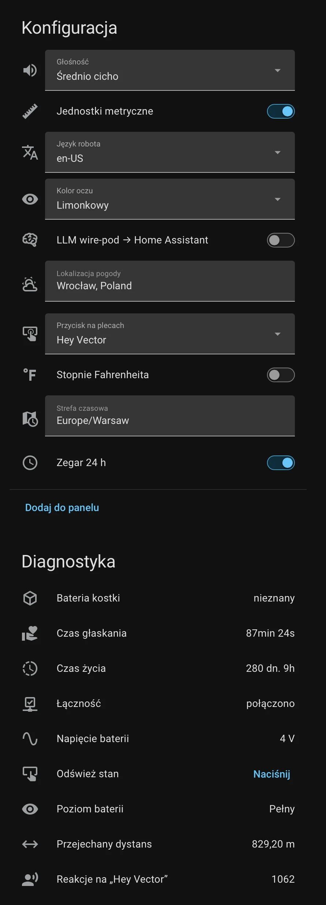

# Vector dla Home Assistant

🇬🇧 [English version](README.md)

Niestandardowa integracja Home Assistant dla robota **Anki / Digital Dream Labs Vector**. Komunikuje
się z robotem przez [dodatek Vector](https://github.com/witold-gren/home-assistant-vector-addon)
(`vector-bridge`), który działa obok [wire-pod](https://github.com/kercre123/wire-pod) i udostępnia
lokalne API WebSocket. Wszystko zostaje w Twojej sieci — bez chmury.

Dzięki niej możesz śledzić czujniki Vectora, sterować nim z dashboardu, korzystać z jego kamery
i głośnika, a także pozwolić mu sterować domem: „Hey Vector, włącz światło w salonie” trafia do
Assist.

## Zrzuty ekranu

**Dashboard**: kafelek z kamerą, baterią i tym, co robi Vector, oraz okno z
[kartą sterowania](#karta-sterowania) (jazda, głowa, ramię, trzymanie, ładowarka).

<table>
  <tr>
    <td width="54%"></td>
    <td width="46%"></td>
  </tr>
</table>

**Integracja**: jeden hub na most, jedno urządzenie na robota i własne komendy głosowe
(**Dodaj komendę**).



**Strona urządzenia**: sterowanie i aktywność; sensory i zdarzenia; konfiguracja i diagnostyka.



<table>
  <tr>
    <td width="50%"></td>
    <td width="50%"></td>
  </tr>
</table>

## Spis treści

- [Zrzuty ekranu](#zrzuty-ekranu)
- [Wymagania](#wymagania)
- [Instalacja](#instalacja)
- [Konfiguracja](#konfiguracja)
- [Encje](#encje)
- [Akcje](#akcje)
- [Głos → Assist](#głos--assist)
- [Własne komendy głosowe](#własne-komendy-głosowe)
- [Zdarzenia](#zdarzenia)
- [Przykłady dashboardów](#przykłady-dashboardów)
- [Ograniczenia](#ograniczenia)

## Wymagania

- Home Assistant 2026.2 lub nowszy.
- Robot Vector (Vector 1.0 lub 2.0) skonfigurowany z **wire-pod**.
- **Dodatek Vector** z repozytorium
  [home-assistant-vector-addon](https://github.com/witold-gren/home-assistant-vector-addon)
  (Home Assistant OS / Supervised) albo inna osiągalna instancja `vector-bridge`.

## Instalacja

### HACS (zalecane)

1. W HACS otwórz menu → **Niestandardowe repozytoria** (*Custom repositories*).
2. Dodaj `https://github.com/witold-gren/home-assistant-vector-integration` z kategorią
   **Integracja** (*Integration*).
3. Zainstaluj **Vector** i uruchom ponownie Home Assistant.

### Ręcznie

Skopiuj `custom_components/vector` do `<config>/custom_components/vector` i uruchom ponownie
Home Assistant.

## Konfiguracja

Gdy dodatek Vector działa, Home Assistant wykrywa go przez Supervisora i proponuje konfigurację
w **Ustawienia → Urządzenia i usługi**. Bez Supervisora dodaj integrację **Vector** ręcznie
(**Dodaj integrację**) i podaj host bridge'a, port (domyślnie `3012`) oraz token.

Każdy robot znany wire-pod staje się urządzeniem. Gdy w wire-pod pojawi się nowy robot, integracja
przeładowuje się i tworzy jego encje.

Opcje integracji (**Konfiguruj**):

| Opcja | Znaczenie |
| --- | --- |
| Agent Assist | Agent konwersacji, który dostaje to, co usłyszał Vector. |
| Vector mówi odpowiedź | Czy Vector wypowiada odpowiedź Assist. |
| Zostaw Vectorowi | Frazy, które zawsze zostają w wire-pod (jedna w linii). |
| Głos odpowiedzi | wire-pod (jego własny TTS, np. Piper) albo silnik TTS z Home Assistant. |
| Silnik TTS / Język TTS / Głos TTS | Używane, gdy głosem odpowiedzi jest silnik TTS z Home Assistant. |
| Agent dla pytań LLM wire-pod | Odpowiada na pytania LLM z wire-pod, gdy ten przełącznik jest włączony. |

## Encje

Nazwy poniżej odpowiadają polskiej wersji Home Assistant. Identyfikatory encji są angielskie w
każdym języku Home Assistant (np. `sensor.vector_battery` także w polskiej instalacji, a nie
`sensor.vector_bateria`); nazwy wyświetlane są przetłumaczone. Przykłady zakładają robota o
nazwie „Vector”.

| Platforma | Encje |
| --- | --- |
| Czujnik binarny | Połączenie, ładowanie, na ładowarce, podniesiony, dotyk, krawędź, śpi, słucha, kostka |
| Czujnik | Bateria, napięcie baterii, poziom baterii, aktywność, pobudzenie, ostatnia twarz, znane twarze, zdjęcia, ostatnia wypowiedź, czas życia, czas głaskania, przejechany dystans, reakcje na „Hey Vector”, bateria kostki |
| Przycisk | Do ładowarki, zjedź z ładowarki, stop, tańcz, eksploruj, idź spać, chodź tu, patrz na mnie, żółwik, zrób sztuczkę, zrób zdjęcie, odwróć się do twarzy, odśwież stan, odśwież obraz kamery, akcje kostki |
| Liczba | Kąt głowy, wysokość podnośnika |
| Wybór | Głośność, kolor oczu, język robota, przycisk na plecach, odtwórz animację |
| Światło | Oczy (dowolny własny kolor) |
| Przełącznik | Ręczne sterowanie, Głos → Home Assistant, LLM wire-pod → Home Assistant, zegar 24 h, jednostki metryczne, stopnie Fahrenheita |
| Tekst | Strefa czasowa, lokalizacja pogody |
| Kamera | Strumień MJPEG na żądanie, zapamiętany zrzut |
| Obraz | Ostatnie zdjęcie |
| Odtwarzacz multimediów | Głośnik Vectora (`tts.speak`, pliki multimedialne, adresy URL audio) |
| Zdarzenie | Hey Vector (słowo wybudzające), kontakt, twarz, zdjęcie, wypowiedź |

Encje kostki są domyślnie wyłączone, dopóki robot nie zna kostki. Zdjęcia Vectora są też dostępne
w przeglądarce multimediów w **Multimedia → Vector**.

## Akcje

Akcje (dawniej: usługi). Wszystkie przyjmują opcjonalny `device_id` (wymagany tylko przy więcej niż
jednym robocie).

| Akcja | Opis |
| --- | --- |
| `vector.say_text` | Vector wypowiada tekst (`engine`: default, wirepod, tts, vector). |
| `vector.play_animation` | Odtwarza animację o podanej nazwie. |
| `vector.play_animation_trigger` | Odtwarza losową animację z grupy (triggera). |
| `vector.list_animations` | Zwraca nazwy animacji (lub triggerów), które zna robot. |
| `vector.run_intent` | Uruchamia zachowanie z komendy głosowej, np. `intent_imperative_dance`. |
| `vector.drive_straight` | Jazda do przodu lub do tyłu. |
| `vector.turn` | Obrót w miejscu. |
| `vector.drive_wheels` | Kręci oboma kołami przez zadany czas, potem zatrzymuje. |
| `vector.move` | Koła, głowa i podnośnik z zadanymi prędkościami; zatrzymuje się 0,7 s po ostatnim wywołaniu. |
| `vector.go_to` | Jazda do punktu z omijaniem przeszkód. |
| `vector.turn_towards_face` | Obrót do znanej twarzy (domyślnie ostatnio widzianej). |
| `vector.go_to_cube` | Jazda do połączonej kostki. |
| `vector.set_eye_color` | Własny kolor oczu do następnej zmiany ustawień lub restartu. |
| `vector.stop` | Przerywa bieżącą czynność i oddaje kontrolę Vectorowi. |
| `vector.list_photos` | Zdjęcia zapisane w robocie, od najnowszych. |
| `vector.delete_photo` | Usuwa zdjęcie zapisane w robocie. |
| `vector.list_faces` | Twarze, które Vector zna z imienia. |
| `vector.rename_face` | Zmienia imię znanej twarzy. |
| `vector.delete_face` | Vector zapomina twarz. |
| `vector.enroll_face` | Vector uczy się twarzy, którą ma przed sobą, pod podanym imieniem. |

## Głos → Assist

Gdy przełącznik **Głos → Home Assistant** jest włączony, każde zdanie, które usłyszy Vector
(rozpoznane przez wire-pod), jest sprawdzane w tej kolejności:

1. **Własne komendy głosowe** (patrz niżej) — dopasowywane lokalnie, obsługuje je Home Assistant.
2. **Zostaw Vectorowi** — jeśli zdanie zawiera jedną z tych fraz, wraca od razu do wire-pod.
   Domyślne frazy zależą od języka Home Assistant (po polsku: „która godzina”, „pogoda”,
   „minutnik”, „zrób zdjęcie”, „zatańcz”, „idź spać”, „dobranoc”, …) i można je zmienić w opcjach.
3. **Assist** — zdanie trafia do skonfigurowanego agenta. Jeśli je zrozumie, Home Assistant wykonuje
   polecenie, a Vector wypowiada odpowiedź (przez TTS z wire-pod albo silnik TTS z Home Assistant,
   patrz *Głos odpowiedzi*). Jeśli agent nie zrozumie albo nie odpowie na czas (~7 s), wire-pod
   obsługuje zdanie jak zwykle (godzina, pogoda, jego własny LLM…).

Przełącznik **LLM wire-pod → Home Assistant** idzie o krok dalej: na pytania, które wire-pod
wysłałby do swojego LLM, odpowiada zamiast niego agent konwersacji Home Assistant.

Czujnik `Ostatnia wypowiedź`, encja zdarzenia `Wypowiedź` i zdarzenie `vector_speech` pokazują,
co zostało usłyszane i co się z tym stało.

## Własne komendy głosowe

Komendy dodajesz w **Ustawienia → Urządzenia i usługi → Vector → Dodaj komendę**. Każda komenda
ma:

- **Zdania**, jedno w linii, w składni Assist:
  - `dobranoc [vector]` — `[...]` jest opcjonalne,
  - `(wyłącz|zgaś) wszystko` — `(a|b)` to warianty do wyboru,
  - `zagraj {utwór}` — `{slot}` pasuje do dowolnego tekstu.
- Opcjonalną **odpowiedź**, którą wypowie Vector; `{utwór}` w odpowiedzi zostanie zastąpione
  dopasowaną wartością.
- Opcjonalny **skrypt**, uruchamiany ze zmiennymi `text`, `slots`, `esn` i `device_id`.
- Opcjonalną **reakcję Vectora** (taniec, sen, żółwik, …) albo **grupę animacji**.

Każde dopasowanie wysyła też zdarzenie `vector_command`. Komendy są sprawdzane przed
*Zostaw Vectorowi* i przed Assist.

## Zdarzenia

| Zdarzenie | Kiedy jest wysyłane |
| --- | --- |
| `vector_wake_word` | Vector usłyszał słowo wybudzające. |
| `vector_touched` | Ktoś dotknął pleców Vectora. |
| `vector_picked_up` | Vector został podniesiony. |
| `vector_cliff` | Vector wykrył krawędź. |
| `vector_button_pressed` | Naciśnięto przycisk na plecach. |
| `vector_face_seen` | Vector widzi twarz. |
| `vector_intent` | Vector rozpoznał intencję głosową. |
| `vector_cube_tapped` | Ktoś stuknął w kostkę. |
| `vector_control_lost` | Robot odebrał kontrolę nad zachowaniem. |
| `vector_photo_taken` | Vector zrobił zdjęcie. |
| `vector_audio_started` | Na głośniku zaczyna się odtwarzanie dźwięku. |
| `vector_audio_finished` | Odtwarzanie dźwięku się skończyło. |
| `vector_speech` | Zdanie przeszło przez router głosowy (tekst, decyzja, odpowiedź). |
| `vector_command` | Dopasowano własną komendę głosową (komenda, sloty, tekst). |

## Przykłady dashboardów

### Karta sterowania

Integracja sama udostępnia kartę `custom:vector-control-card` — nie trzeba dodawać zasobu
Lovelace. Interfejs karty jest po angielsku albo po polsku, gdy Home Assistant ma ustawiony
język polski.

```yaml
type: custom:vector-control-card
camera: camera.vector
# speed: 120      # mm/s do przodu (opcjonalnie)
# hold: true      # przejmij kontrolę, gdy karta jest otwarta (domyślnie)
```

- **Jazda z przytrzymaniem**: strzałki oraz przyciski głowy i ramienia poruszają Vectorem tylko
  wtedy, gdy są wciśnięte. Karta powtarza `vector.move` co 300 ms, a Vector zatrzymuje się 0,7 s
  po ostatnim wywołaniu, więc staje także wtedy, gdy zerwie się połączenie albo zamkniesz okno.
  **STOP** zatrzymuje wszystko.
- **Automatyczne trzymanie**: gdy karta jest otwarta, włącza przełącznik *Ręczne sterowanie*, więc
  Vector stoi w miejscu i czeka na polecenia. Trzymanie jest odnawiane co 5 minut i zwalniane po
  zamknięciu karty. Wyłączysz je przez `hold: false` albo przełącznikiem **Trzymaj** na karcie.
- **Na ładowarce** pojawia się pasek z przyciskiem **Zjedź z ładowarki**, a strzałka do przodu
  zjeżdża Vectorem z ładowarki.
- **Kamera**: strumień działa tylko wtedy, gdy karta jest otwarta; zamknięcie karty wyłącza kamerę.

### Okno popup z browser_mod

Z [browser_mod](https://github.com/thomasloven/hass-browser_mod) kafelek może otworzyć kartę wraz
z kilkoma przyciskami zachowań w oknie popup:

```yaml
type: tile
entity: sensor.vector_battery
name: Vector
icon: mdi:robot-happy
tap_action:
  action: fire-dom-event
  browser_mod:
    service: browser_mod.popup
    data:
      title: Vector
      content:
        type: vertical-stack
        cards:
          - type: custom:vector-control-card
            camera: camera.vector
          - type: grid
            columns: 4
            square: false
            cards:
              - type: tile
                entity: button.vector_dance
                vertical: true
                hide_state: true
                tap_action:
                  action: perform-action
                  perform_action: button.press
                  target:
                    entity_id: button.vector_dance
              # … tak samo dla button.vector_look_at_me, button.vector_fist_bump, button.vector_go_to_sleep
```

Identyfikatory encji zależą od języka Home Assistant w chwili konfiguracji integracji (np.
polska instalacja dostaje polskie identyfikatory encji). Sprawdź swoje w
**Ustawienia → Urządzenia i usługi → Encje**.

## Ograniczenia

- **Obrazy na ekranie twarzy** nie są obsługiwane: na Vectorze 2.0 wysłanie obrazu na ekran twarzy
  zawiesza robota.
- **Kamera** działa z prędkością około 2 klatek na sekundę (MJPEG przez bridge).
- **Kamera na ładowarce**: gdy Vector stoi na ładowarce, kamera wymaga przejęcia kontroli nad
  zachowaniem, więc Vector stoi nieruchomo, dopóki ktoś ogląda strumień.
- Długie lub nieskończone strumienie audio nie są obsługiwane na głośniku; bridge odtwarza całe
  pliki (do 50 MB).

## Licencja

[MIT](LICENSE)
